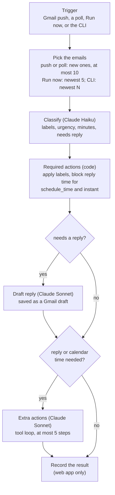

# Email agent

An email agent that works inside Gmail. For each new email it adds labels, takes the
action that matches the email's urgency, drafts a reply when someone is waiting for
one, and lets Claude take any extra steps that would help. Replies are only ever saved
as drafts, never sent.

## How it works



1. **Trigger.** The web scheduler runs every 5 minutes for each enabled user, and
   when someone clicks "Run now". With [Gmail push](docs/gmail-push.md) set up, it
   runs within seconds of an email arriving instead, and polls only as a fallback. The CLI processes the newest N emails of the
   `token.json` account.
2. **Classify** (Claude Haiku). Picks 0 to 3 labels from your Gmail labels, using the
   label descriptions each user edits on the web app's Labels tab (new users start
   from [triage/labels.md](triage/labels.md), which the CLI uses). Also returns the urgency, the minutes
   needed to reply, and whether a reply is needed. The Labels tab and Gmail only
   ever add to each other: a label added on the tab is created in Gmail, and a label
   made by hand in Gmail gets a row on the tab to describe. Renames and deletions
   stay on the side where they were made.
3. **Required actions** (code). Applies the labels, then runs the action for the
   urgency: `not_urgent` needs nothing more, `schedule_time` blocks
   calendar time next to other email time (usually within a day), and `instant`
   blocks the first free time, within the hour unless meetings are in the way.
   Reply blocks start 5 to 10 minutes after a meeting ends and never sit right
   before the next one, so after back-to-back meetings they come after the last one.
   Reply time stays within working hours, unless the user turns on "Super-urgent
   emails after hours" in Settings, which lets `instant` blocks go in the evening and at weekends.
4. **Draft reply** (Claude Sonnet). Runs only when a reply is needed. Follows
   [triage/skills/write-reply/SKILL.md](triage/skills/write-reply/SKILL.md) and saves a Gmail draft.
5. **Extra actions** (Claude Sonnet). Only for emails that need a reply or calendar time; newsletters,
   receipts and alerts skip it. A tool loop of at most 5 steps that can call the
   tools in [triage/actions.py](triage/actions.py) for anything beyond the required minimum.

See [docs/system-design.md](docs/system-design.md) for the infrastructure, its
trade-offs and where it breaks first. The first agent outline and the old feature
specs are in [docs/archive/](docs/archive/); they are no longer updated.

## Repo layout

| Folder | What's in it |
| --- | --- |
| `triage/` | The email triage itself (no Django): the fixed pipeline (`pipeline.py`), the agent step (`agent.py`), actions, Gmail and Calendar wrappers, labels, skills |
| `accounts/` | The Django app: users, models, views, templates, the scheduler and the per-user runner |
| `config/` | Django settings and URLs |
| `evals/` | Eval tools: build a reviewed test set, benchmark accuracy and cost, compare runs (data stays in the gitignored `eval_data/` and `eval_runs/`) |
| `deploy/` | Container entrypoint (`Dockerfile`, `railway.json` and `render.yaml` stay at the root for the hosts) |
| `docs/` | System design, tech stack, hosting and Gmail push guides |

## Setup

Requires [uv](https://docs.astral.sh/uv/).

```bash
make setup
```

This installs the dependencies, creates `.env` from `.env.example` and sets up the
database. Then add your `ANTHROPIC_API_KEY` to `.env` (a bearer token in
`ANTHROPIC_AUTH_TOKEN` works too; `make check-key` shows which one is used and
whether it works). For the web app, also add the Google OAuth client values.

## Usage

```bash
make dev        # web app on http://localhost:8000, plus the scheduler
make agent N=3  # CLI: process the newest 3 emails (needs credentials.json)
make agent N=50 DRY_RUN=1  # eval mode: changes nothing, saves the would-be actions to eval_runs/
make test       # run the tests
make demo       # web app with a fake Gmail, to try UI changes (see below)
make labels     # create users' labels in Gmail where Gmail doesn't have them yet
make check-key  # check the Anthropic credential (free)
```

`make demo` runs the web app on http://localhost:8765 against an in-memory fake
Gmail and its own `demo.db`, so no Google account is needed and nothing touches a
real inbox. Log in with `demo@example.com` / `demo-password`, in a normal browser:
Conductor's built-in browser drops the CSRF cookie. To make a label "by hand in
Gmail", open `http://localhost:8765/fake-gmail/add/?name=Music` and reload the
Labels tab. Details in [accounts/demo.py](accounts/demo.py).

`DRY_RUN=1` (eval mode) reads Gmail and Calendar as usual but records every write
(labels, drafts, calendar blocks) instead of making it. Later steps in the same
run see those simulated writes, so a dry run behaves like a live one.

Run `make help` to see every command.

### Evals

Four commands. Your emails, answers and results stay in `eval_data/` and
`eval_runs/`, both gitignored.

**1. Build the dataset.** Every email is reviewed by you before it counts.

```bash
make eval-export N=50   # pull 50 new emails, pre-fill with the agent's decisions, open the review page
make eval-review        # reopen the review page later (http://127.0.0.1:8765)
```

**2. Benchmark and compare.** A benchmark runs the whole live system (classify,
labels, calendar, draft, agent loop) on every reviewed email in dry run, so
Gmail and Calendar never change. It reports accuracy, cost per email, per month
and emails per $1, and asks before spending.

```bash
make bench NAME=current                  # the system as the code is now
make bench NAME=all-sonnet CLASSIFY=sonnet   # the same system with another model for a step
make bench NAME=no-loop AGENT=none       # partial: skip the agent loop
make bench-review                        # page: compare two saved runs, flag the prod one
```

## Hosting

To keep the agent running when your laptop is off, deploy the Docker image to
Railway (about $5 a month, [docs/deploy-railway.md](docs/deploy-railway.md)) or Render
(about $7.25 a month, [docs/deploy-render.md](docs/deploy-render.md)).
