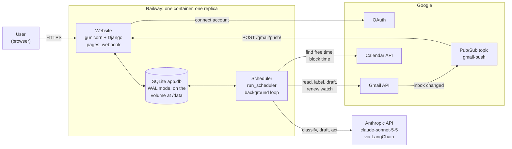
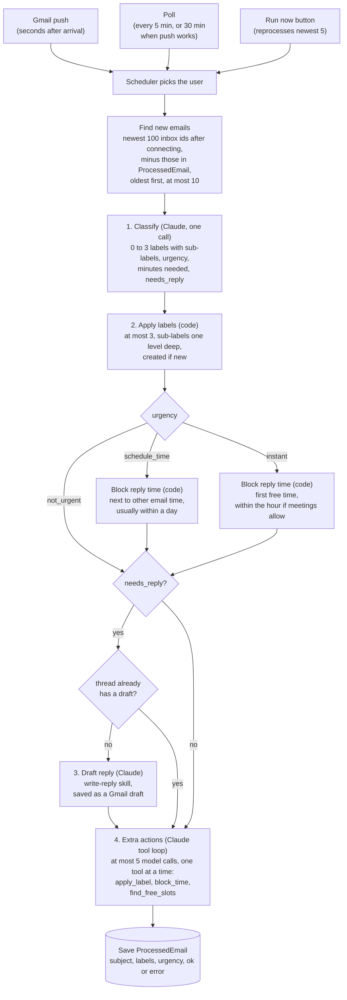
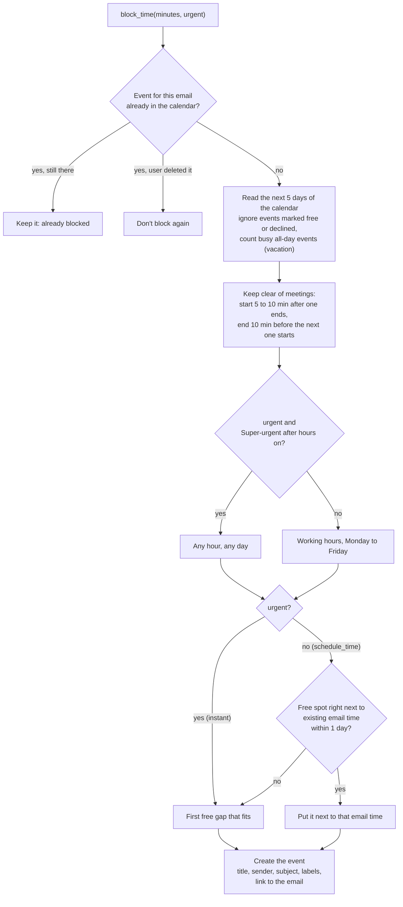
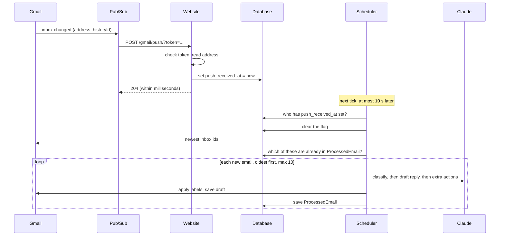
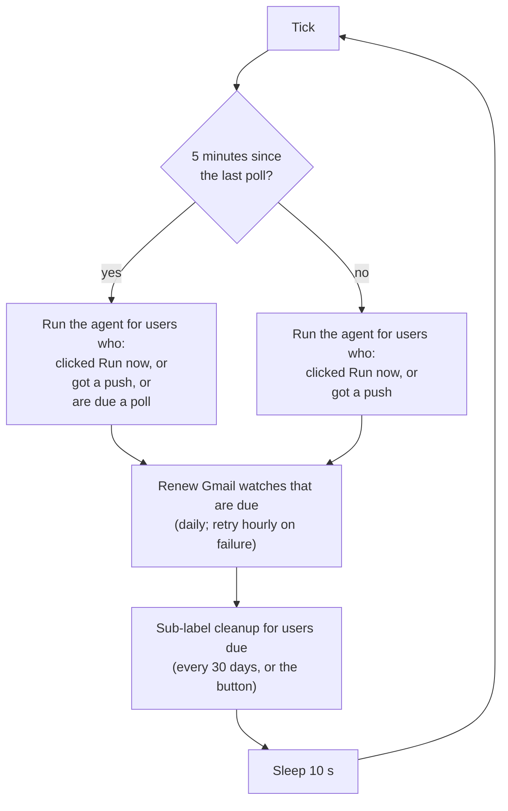
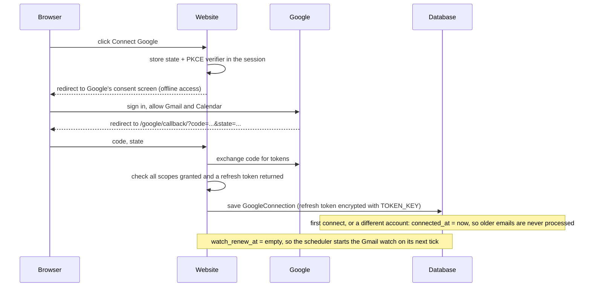
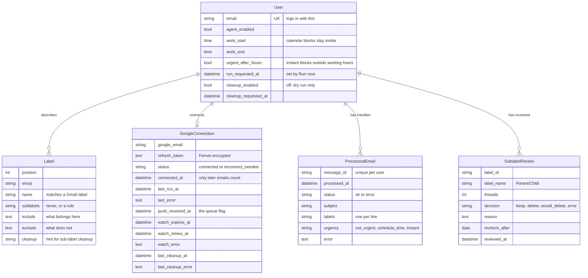

# System design

How the email agent works, how it is put together, why each choice was made, and
where it breaks first. Update this file (and its diagrams) in every PR that changes
triggers, storage, hosting or the steps per email.

**Contents**

1. [The system in one paragraph](#the-system-in-one-paragraph)
2. [Infrastructure](#infrastructure)
3. [The life of one email](#the-life-of-one-email)
4. [From Gmail to the agent: push and polling](#from-gmail-to-the-agent-push-and-polling)
5. [The scheduler loop](#the-scheduler-loop)
6. [Connecting a Google account](#connecting-a-google-account)
7. [Data model](#data-model)
8. [Choices and trade-offs](#choices-and-trade-offs)
9. [Where it can fail](#where-it-can-fail)
10. [Limits that come from outside](#limits-that-come-from-outside)
11. [Where things live in the code](#where-things-live-in-the-code)

## The system in one paragraph

A user signs up on the website and connects their Google account. From then on, every
new email in their inbox is handled by the agent: Claude picks labels and an urgency,
code applies the labels and blocks calendar time to reply (within the hour for
super-urgent emails, otherwise next to other email time), Claude drafts a reply if someone is waiting for one, and Claude may take a few
extra steps. Replies are only ever saved as drafts, never sent. Gmail tells the app
about new emails through Google Cloud Pub/Sub within seconds; a poll every 5 to 30
minutes catches anything that slips through. Everything runs in one container on
Railway: a Django website and a background scheduler that share one SQLite file.

## Infrastructure

| Part | What it is | What it does |
|---|---|---|
| **Website** | Django, served by gunicorn (1 worker, 4 threads) | Sign-up, login, dashboard, label editor, Google connect, "Run now", and the Pub/Sub webhook. Only does quick work. |
| **Scheduler** | `python manage.py run_scheduler`, a plain `while True` loop | All the slow work: running the agent, renewing Gmail watches, monthly sub-label cleanup. |
| **Database** | One SQLite file on a Railway volume | Users, their labels, Google connections, and a record of every email handled. Also the job queue (see [choice 3](#choices-and-trade-offs)). |
| **Container** | `Dockerfile` + `deploy/start.sh` | Runs migrations, then starts the website and the scheduler side by side. If either one exits, the container exits and Railway restarts it. |
| **Google** | OAuth, Gmail, Calendar, Pub/Sub | Each user's mail and calendar, accessed with their own refresh token. Scopes: `gmail.modify`, `calendar.readonly`, `calendar.events`. |
| **Anthropic** | Claude through `langchain-anthropic` | Classification, reply drafting, the extra-actions tool loop, and sub-label cleanup decisions. |

Hosting on Render instead works the same way (`render.yaml`, [deploy-render.md](deploy-render.md)).
Locally, `make dev` runs the website and the scheduler against `./app.db`, and
`make agent` runs the agent once from the CLI for the `token.json` account, with no
website or database.

## The life of one email

Steps 1 to 3 are the **required minimum**: code always runs them, in that order, so
they happen even if Claude takes no extra steps. Step 4 is Claude's own choice and is
often empty. The labels Claude may pick, and what each one is for, come from the
user's label descriptions on the Labels page (new users start from
[labels.md](../labels.md)).

`instant` is for the rare super-urgent email: a same-day deadline, a problem happening
now, or someone blocked until the user answers. How the reply block is placed is shown
in [Placing a reply block](#placing-a-reply-block).

### Placing a reply block

"Email time" means the agent's earlier reply blocks and the user's own events with
"reply", "email" or "inbox" in the title. Grouping replies next to them keeps email
work in batches; urgent replies skip the grouping and take the first free time. If
nothing fits in the next 5 days, the block is skipped and a line is printed to the
scheduler log. The email is still saved as `ok`, so the dashboard doesn't show it.

Typical time per email: 10 to 30 seconds of Claude work (two or three calls, plus
the tool loop).

## From Gmail to the agent: push and polling

The webhook never does Gmail or Claude work. It only sets a flag, so it answers before
Pub/Sub's 10-second deadline and Pub/Sub never retries. The flag is cleared **before**
the run starts, so an email that arrives during a run triggers another run.

The run doesn't trust the notification's content. It looks at the newest inbox emails
and skips the ones already in `ProcessedEmail`. So a lost, late or duplicate
notification can neither skip nor double-process an email. Notifications for changes
that aren't new emails (the agent's own labels, the user archiving) cost two cheap
Gmail calls and no Claude call.

Polling stays on as a fallback:

| User's push state | Polled every |
|---|---|
| Push not configured (`GMAIL_PUBSUB_TOPIC` / `GMAIL_PUSH_TOKEN` unset) | 5 minutes |
| Watch failed or expired | 5 minutes |
| Watch working | 30 minutes |

Setup steps for Pub/Sub are in [gmail-push.md](gmail-push.md).

## The scheduler loop

Everything in one tick runs in sequence: one user at a time, one email at a time.
Only users whose agent is enabled and whose Google connection is `connected` are run
(Run now works even with the agent switched off).

**Sub-label cleanup** is a separate, monthly job (`sublabel_cleanup.py`). Code picks
sub-labels that have gone quiet, Claude decides keep or delete for each, and each
decision is saved as a `SublabelReview`. It only deletes when the user has turned
cleanup on; otherwise it reports what it would delete. Its errors never touch the
email agent's status, and the other way round. Details:
[sublabel-cleanup-spec.md](sublabel-cleanup-spec.md).

## Connecting a Google account

Reconnecting the **same** account keeps the old `connected_at`, so the first run
afterwards catches up on emails that arrived while it was disconnected (the newest 100
inbox ids, 10 per run). Connecting a **different** account resets it, so that account's
existing inbox is left alone.

The app only stores the **refresh token**, encrypted with Fernet. Each run builds fresh
credentials from it. If Google refuses the token (expired or revoked), the run catches
`RefreshError`, marks the connection `reconnect_needed`, and the dashboard asks the user
to reconnect. Disconnecting stops the Gmail watch, revokes the token at Google and
deletes the connection.

## Data model

What lives where:

- **In the database:** who the users are, what each label means to them, how to reach
  their Google account, and a log of what the agent did. `ProcessedEmail` doubles as
  the "already done" list that makes runs safe to repeat.
- **In Gmail and Calendar:** everything the user sees. Labels, sub-labels, drafts and
  calendar blocks are real Gmail and Calendar objects. The app keeps no copy of email
  content; it reads each email, sends it to Claude, and keeps only the subject.
- **In the repo:** the default labels (`labels.md`), the reply-writing instructions
  (`skills/write-reply/SKILL.md`), and the prompts (`agent.py`).

## Choices and trade-offs

| # | Choice | Why | Where it breaks first | Upgrade path |
|---|---|---|---|---|
| 1 | **Gmail push via Pub/Sub**, polling as fallback | Gmail can only notify through Pub/Sub. Reacts in seconds instead of minutes. | Needs a public HTTPS URL; a lost ping waits for the 30-minute fallback poll. | Pull subscription (no public URL, needs a Google Cloud key). |
| 2 | **Webhook only sets a flag**, never does AI work | Pub/Sub waits about 10 s for an answer and retries otherwise. Answering fast avoids duplicate pings. | Nothing at this size. | None needed. |
| 3 | **Database as the queue** (`GoogleConnection.push_received_at`) | No extra server. Survives restarts. 20 pings at once become one run. | Thousands of jobs a minute, or several workers grabbing the same user. | Postgres with `SELECT ... FOR UPDATE SKIP LOCKED`, then Redis + RQ/Celery. |
| 4 | **Scheduler polls the database every 10 s** | Simplest worker loop; 10 s is small next to 10 to 30 s of AI work. | When seconds matter. | Wake the worker instantly (Postgres `LISTEN/NOTIFY` or a Redis queue). |
| 5 | **One worker, one user at a time, one email at a time** | No races on labels; easy to reason about. | Many users: user B waits for user A's whole run. | Run users in parallel (one worker per user at a time, emails in order). |
| 6 | **"What's new" = newest inbox ids not in `ProcessedEmail`** | A lost or duplicate ping can't skip or double-process an email. No Gmail history id to go stale. | An inbox getting more than 100 new emails between runs (`LOOKBACK`). | Gmail `history.list` from a stored history id. |
| 7 | **At most 10 emails per run** (`MAX_PER_RUN`) | Keeps one run short and limits the cost of a mistake. | A burst of more than 10 emails takes several runs. | Raise the limit once runs are parallel. |
| 8 | **SQLite** in WAL mode | Zero setup, one file, fine for one server. | Many simultaneous writers; more than one server. | Postgres. |
| 9 | **One server only** | The scheduler must not run twice, or emails get two drafts. | Running a second copy (also: `make dev` locally while the hosted app runs). | A real queue with locking (row 3) makes several workers safe. |
| 10 | **Watch renewed daily**, retried hourly on failure | Google expires watches after 7 days and recommends renewing daily. | A broken Pub/Sub setup; the dashboard shows the error and polling takes over every 5 min. | None needed. |
| 11 | **Required steps in code, extras by Claude** | Labels, calendar blocks and drafts happen every time, in a fixed order, and can be tested. Claude only adds to them. | Rules that need judgement the code can't express. | Move a step to Claude only once it has tests. |
| 12 | **Drafts only, never send** | A wrong draft costs the user a delete; a wrong sent email can't be undone. | Users who want true autopilot. | Per-label opt-in to sending, with a delay to cancel. |
| 13 | **Each step is safe to repeat** | A crash or rerun mid-email must not duplicate work. Labels are idempotent, a draft is skipped if the thread has one, a calendar block is found by its message id. | An extra action without its own check, if one is added later. | Record each extra action and skip repeats. |
| 14 | **Structured output for every one-shot Claude call** | Claude's native JSON schema mode; the label list is an enum built from Gmail per run, so Claude can't invent a top-level label. | Very long label lists make the schema large. | None needed yet. |

## Where it can fail

What breaks, what the user sees, what the app does about it, and how to fix it.

| What fails | What the user sees | What the app does | Fix |
|---|---|---|---|
| **Google sign-out every 7 days.** OAuth apps in *Testing* mode get refresh tokens that expire after 7 days. | Dashboard: "Reconnect Google". The agent stops for that user. | Catches `RefreshError`, sets the connection to `reconnect_needed`, and skips the user until they reconnect. | Publish the OAuth app (Google Cloud → OAuth consent screen → *In production*). Until then, reconnect weekly. |
| **User revokes access** in their Google account. | Same as above. | Same as above. | Reconnect. |
| **Two copies running** (a second replica, a second deploy, or `make dev` locally while the hosted app runs). | Possible double drafts or calendar blocks when both handle the same email at the same moment. | Nothing stops it: each copy has its own database. The "thread has a draft" and "block exists" checks catch most repeats, but not a true race. | Keep one replica (`railway.json` sets `numReplicas: 1`). Don't connect the same Google account locally and on the server. |
| **Container restarts** (deploy, crash, Railway maintenance). | Nothing, or a delay of a few seconds. | Pub/Sub retries pings that got no answer. An email interrupted mid-way has no `ProcessedEmail` yet, so the next run redoes it; every step is safe to repeat ([choice 13](#choices-and-trade-offs)). | None needed. |
| **Push ping lost**, or the watch can't be created (wrong topic, missing Publisher grant). | Emails handled in up to 30 minutes instead of seconds. A broken watch shows on the dashboard with "polling instead". | Lost ping: the 30-minute fallback poll catches it. Broken watch: polls every 5 minutes, retries the watch hourly. | Fix the Pub/Sub setup ([gmail-push.md](gmail-push.md)). |
| **Gmail quota or server errors** (429, 5xx). | Slower runs. | Each Gmail call retries 8 times with backoff (about 4 minutes in total). If it still fails, that email is saved as `error` and is **not** retried automatically. | "Run now" reprocesses the newest 5 emails. |
| **Anthropic errors** (rate limit, overload, outage, bad key). | Dashboard shows the error; new emails wait. | LangChain retries twice. Then the run stops without saving the email, so the next run (push or poll) tries it again. | Wait, or check the API key and usage limits. |
| **Claude refuses or returns unusable output.** | That email shows as `error` on the dashboard. | Saved as `error`, not retried. The run continues with the next email. | "Run now", or handle the email by hand. |
| **No labels in Gmail**, or labels renamed so they no longer match their descriptions. | Dashboard error "No labels in Gmail", or emails labelled less well. | Stops the run, or logs a warning per mismatch. | Create the labels in Gmail; use "Add missing labels" on the Labels page. |
| **More than 100 new emails between two runs.** | The oldest ones are never handled. | Only the newest 100 inbox ids are checked (`LOOKBACK`). | Rare with push. Raise `LOOKBACK` or switch to `history.list` ([choice 6](#choices-and-trade-offs)). |
| **Volume missing or not mounted.** | Every deploy wipes all accounts and connections. | SQLite falls back to the container's own disk. | Mount a volume at `/data` ([deploy-railway.md](deploy-railway.md)). |
| **`TOKEN_KEY` changed or lost.** | Everyone has to reconnect Google. | Stored refresh tokens can no longer be decrypted. **Known gap:** the decrypt happens outside the run's error handling, so the scheduler crashes and the container restarts in a loop until the connections are removed. | Keep `TOKEN_KEY` safe. If it changed, delete the `GoogleConnection` rows (admin) and reconnect. |
| **Webhook secret leaked.** | Nothing visible. | Anyone with it can trigger extra runs; they find nothing new and stop. It can't read or change mail. | Rotate `GMAIL_PUSH_TOKEN` and update the subscription's endpoint. |

## Limits that come from outside

- **Anthropic API rate limits** are the real ceiling once there are many users, not the code.
- **Gmail API quota** is per user (250 units per second) and far above what one inbox needs.
- **Google OAuth in Testing mode** expires refresh tokens after 7 days and allows at most 100 test users. Publish the OAuth app before relying on it.
- **Pub/Sub** free tier (10 GB a month) covers this many times over.

## Where things live in the code

| Area | Files |
|---|---|
| The agent (classify, required steps, draft, tool loop) | `agent.py` |
| Actions the code and Claude call | `actions.py` |
| Google API wrappers | `gmail.py`, `gcal.py`, `google_auth.py` (CLI only) |
| Whose account a run uses | `run_context.py` |
| Label descriptions | `labels.py`, `labels.md`, `accounts.models.Label` |
| Reply-writing instructions | `skills/write-reply/SKILL.md` |
| Running the agent for one web user | `accounts/runner.py` |
| Scheduler loop | `accounts/management/commands/run_scheduler.py` |
| Gmail push (webhook, watches) | `accounts/push.py`, `accounts/views.py` (`gmail_push`) |
| Google connect (OAuth web flow, token encryption) | `accounts/google_connect.py`, `accounts/views.py` |
| Sub-label cleanup | `sublabel_cleanup.py`, `accounts/cleanup_runner.py` |
| Data model | `accounts/models.py` |
| Hosting | `Dockerfile`, `deploy/start.sh`, `railway.json`, `render.yaml` |

## Related docs

- [agent_outline.md](../agent_outline.md): the agent's tools, skills, limits and guardrails.
- [gmail-push.md](gmail-push.md): Google Cloud setup for push.
- [deploy-railway.md](deploy-railway.md) and [deploy-render.md](deploy-render.md): hosting.
- [sublabel-cleanup-spec.md](sublabel-cleanup-spec.md) and [user-labels-spec.md](user-labels-spec.md): feature specs.
- [../STACK.md](../STACK.md): libraries and versions.
