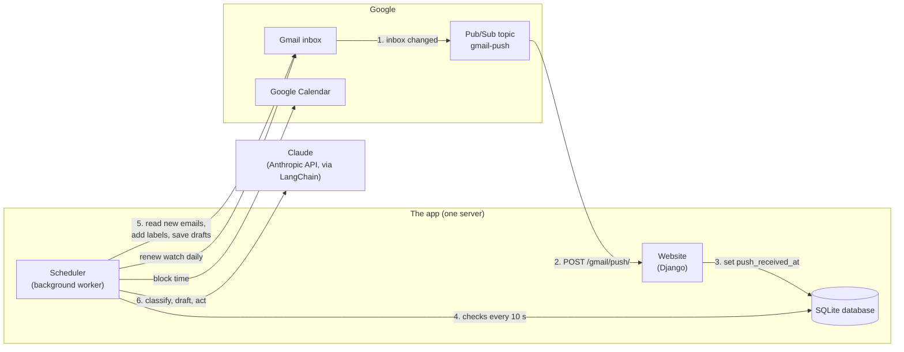
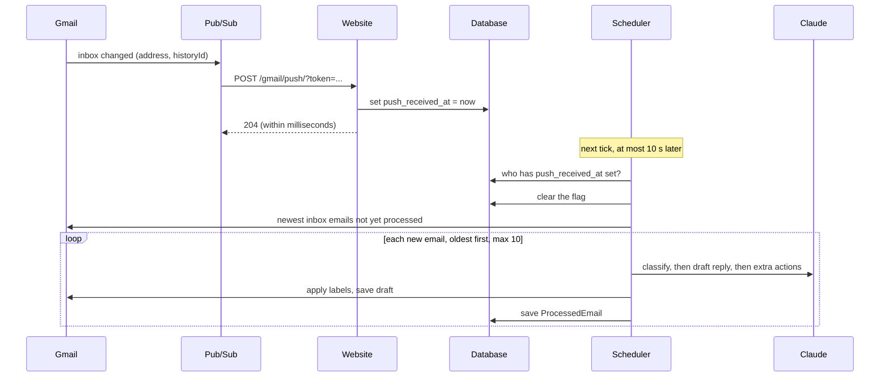

# System design

How the email agent is put together, why each choice was made, and where each one
breaks first. Update this file (and its diagrams) whenever one of these choices changes.

## The big picture

There are two programs, the **website** and the **scheduler**, and they share one
database. The website only does quick things. The scheduler does all the slow work.

## What happens when an email arrives

Typical delay from email to draft: up to 10 seconds of waiting, then 10 to 30 seconds
of Claude work per email.

## Choices, trade-offs, and where each fails

| # | Choice | Why | Where it breaks first | Upgrade path |
|---|---|---|---|---|
| 1 | **Gmail push via Pub/Sub**, polling as fallback | Gmail can only notify through Pub/Sub. Reacts in seconds instead of minutes. | Needs a public HTTPS URL; a lost ping waits for the 30-minute fallback poll. | Pull subscription (no public URL, needs a Google Cloud key). |
| 2 | **Webhook only sets a flag**, never does AI work | Pub/Sub waits about 10 s for an answer and retries otherwise. Answering fast avoids duplicate pings. | Nothing at this size. | None needed. |
| 3 | **Database as the queue** (`GoogleConnection.push_received_at`) | No extra server. Survives restarts. 20 pings at once become one run. | Thousands of jobs a minute, or several workers grabbing the same user. | Postgres with `SELECT ... FOR UPDATE SKIP LOCKED`, then Redis + RQ/Celery. |
| 4 | **Scheduler polls the database every 10 s** | Simplest worker loop; 10 s is small next to 10 to 30 s of AI work. | When seconds matter. | Wake the worker instantly (Postgres `LISTEN/NOTIFY` or a Redis queue). |
| 5 | **One worker, one user at a time, one email at a time** | No races on labels; easy to reason about. | Many users: user B waits for user A's whole run. | Run users in parallel (one worker per user at a time, emails in order). |
| 6 | **"What's new" = newest inbox ids not in `ProcessedEmail`** | A lost or duplicate ping can't skip or double-process an email. No Gmail history id to go stale. | An inbox getting more than 100 new emails between runs (`LOOKBACK`). | Gmail `history.list` from a stored history id. |
| 7 | **At most 10 emails per run** (`MAX_PER_RUN`) | Keeps one run short and limits the cost of a mistake. | A burst of more than 10 emails takes several runs. | Raise the limit once runs are parallel. |
| 8 | **SQLite** in WAL mode | Zero setup, one file, fine for one server. | Many simultaneous writers; more than one server. | Postgres. |
| 9 | **One server only** | The scheduler must not run twice, or emails get two drafts. | Running a second copy (also: `make dev` locally while the hosted app runs). | A real queue with locking (row 3) makes several workers safe. |
| 10 | **Watch renewed daily**, retried hourly on failure | Google expires watches after 7 days and recommends renewing daily. | A broken Pub/Sub setup; the dashboard shows the error and polling takes over every 5 min. | None needed. |

## Limits that come from outside

- **Anthropic API rate limits** are the real ceiling once there are many users, not the code.
- **Gmail API quota** is per user (250 units per second) and far above what one inbox needs.
- **Google OAuth in Testing mode** expires refresh tokens after 7 days. Publish the OAuth app before relying on it.

## Related docs

- [gmail-push.md](gmail-push.md): Google Cloud setup for push.
- [../STACK.md](../STACK.md): libraries and versions.
- [../agent_outline.md](../agent_outline.md): what the agent does with each email.
